<!-- cards:start -->

  
  
  

<!-- cards:end -->

> _"Como estudante de Engenharia de Software, minha visão sobre o futuro da tecnologia vai muito além do que vejo hoje nas salas de aula e nos materiais de estudo. Minha filosofia de vida e de carreira é guiada por uma convicção clara: a verdadeira inovação não deve nos afastar da nossa natureza, mas sim nos devolver a qualidade de vida."_

Os cartões acima são gerados por <code>render_cards.py</code> e atualizados todo dia por uma GitHub Action.
